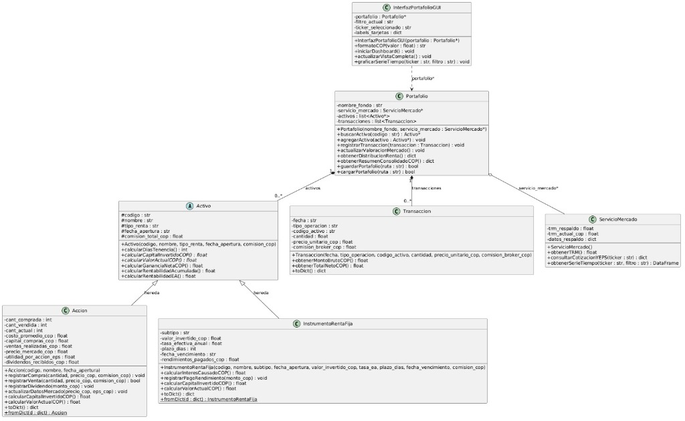

# Sistema de Seguimiento y Valoración de Portafolio de Inversión (Python & yfinance)

Entrega del curso **Estructura de Datos**. Proyecto desarrollado en **Python** bajo el paradigma de Programación Orientada a Objetos (POO) para el monitoreo contable, valoración en tiempo real y cálculo de rentabilidades de un portafolio mixto (**Renta Variable** y **Renta Fija**) expresado en **Pesos Colombianos (COP)**, inspirado en los informes de rentabilidad de Fondos de Inversión Colectiva (FIC) de Bancolombia.

## Descripción del Proyecto
El sistema administra la contabilidad de un conjunto de inversiones registrando operaciones de compra, venta, cobro de dividendos, rendimientos de renta fija y comisiones de bróker, determinando si cada activo y el portafolio consolidado se valorizaron o se desvalorizaron:

1. **Activos de Renta Variable (Acciones con `yfinance`):**
   - Control de inventario de títulos: cantidad de acciones compradas, cantidad de acciones vendidas y posición actual en cartera.
   - Integración en tiempo real con Yahoo Finance (`yfinance`) para consultar precios de mercado, **EPS (Utilidad por Acción)** y conversión automática a **Pesos Colombianos (COP)** mediante la TRM vigente (`USDCOP=X`).
   - Registro y contabilización de dividendos pagados por las empresas emisoras.
2. **Activos de Renta Fija (CDT, Bonos y TES):**
   - Valoración contractual considerando capital invertido, plazo en días, fecha de apertura, fecha de vencimiento, tasa Efectiva Anual (E.A.) pactada y rendimientos o pagos de capital recibidos.
3. **Series de Tiempo e Interfaz Gráfica (Dashboard):**
   - Visualización interactiva del cambio de precio de cada acción en intervalos de tiempo filtrables por: **1 Día (`1D`), 1 Semana (`1S`), 1 Mes (`1M`), 6 Meses (`6M`), 1 Año (`1A`) y 5 Años (`5A`)**.
   - Tablero consolidado en COP con Valor Total Invertido, Valor Actual del Portafolio, Comisiones Totales, Rentabilidad Acumulada (%), Rentabilidad Efectiva Anual (E.A. %) y distribución porcentual entre Renta Fija y Renta Variable.

## Diagrama de Clases UML

## Modelo Financiero de Valoración y Rentabilidad
- **Rentabilidad Acumulada ($R_{\text{acum}}$):**
  $$R_{\text{acum}} = \left( \frac{\text{Valor Actual + Rendimientos/Dividendos - Comisiones} - \text{Capital Invertido}}{\text{Capital Invertido}} \right) \times 100$$
- **Rentabilidad Efectiva Anual ($E.A.$ - Estándar FIC Bancolombia):**
  $$E.A. = \left[ \left( 1 + \frac{R_{\text{acum}}}{100} \right)^{\frac{365}{\text{Días Transcurridos}}} - 1 \right] \times 100$$

## Organización Modular (Una Clase por Archivo)
- `src/activo.py`: Clase abstracta `Activo` con los atributos e interfaz base de valoración.
- `src/transaccion.py`: Clase `Transaccion` para el registro de operaciones de compra/venta y comisiones del bróker.
- `src/accion.py`: Clase `Accion` para renta variable, control de acciones compradas/vendidas, dividendos y EPS.
- `src/renta_fija.py`: Clase `InstrumentoRentaFija` para CDT, Bonos y TES.
- `src/servicio_mercado.py`: Clase `ServicioMercado` conectada a `yfinance` para precios en COP, EPS y series de tiempo.
- `src/portafolio.py`: Clase controladora `Portafolio` para cálculo de rentabilidades (Acumulada y E.A.) y persistencia.
- `src/interfaz_portafolio.py`: Clase `InterfazPortafolioGUI` con dashboard visual (`Tkinter` + `Matplotlib`).
- `main.py`: Archivo principal desde donde se cargan los demás módulos e inicia la aplicación.

## Distribución de Actividades, Ramas y Commits
- **[Teojz] (Rama `feature/mercado-y-portafolio`):** Implementación de `ServicioMercado` (`src/servicio_mercado.py`) con `yfinance`, conversión a COP, EPS y series de tiempo; motor financiero `Portafolio` (`src/portafolio.py`) para cálculo de Rentabilidad Acumulada y Efectiva Anual (E.A.), archivo principal `main.py` y arquitectura UML.
- **[Carlos10marin] (Ramas `feature/modelos-activos` y `feature/renta-variable`):** Implementación de la clase abstracta `Activo` (`src/activo.py`), clase `Transaccion` (`src/transaccion.py`) con control de comisiones de bróker, y clase `Accion` (`src/accion.py`) con control de acciones compradas/vendidas, dividendos y EPS.
- **[ArleyBuritica8] (Ramas `feature/renta-fija` y `feature/dashboard-visual`):** Implementación de la clase `InstrumentoRentaFija` (`src/renta_fija.py`) para CDT, Bonos y TES; interfaz gráfica `InterfazPortafolioGUI` (`src/interfaz_portafolio.py`) con filtros de series de tiempo, portafolio semilla (`data/portafolio_bancolombia.json`) y Wiki del repositorio.
